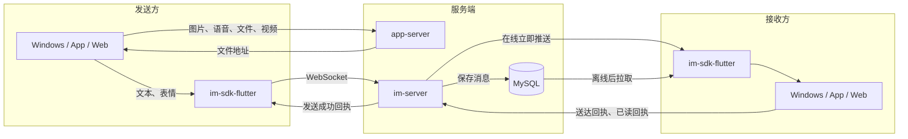
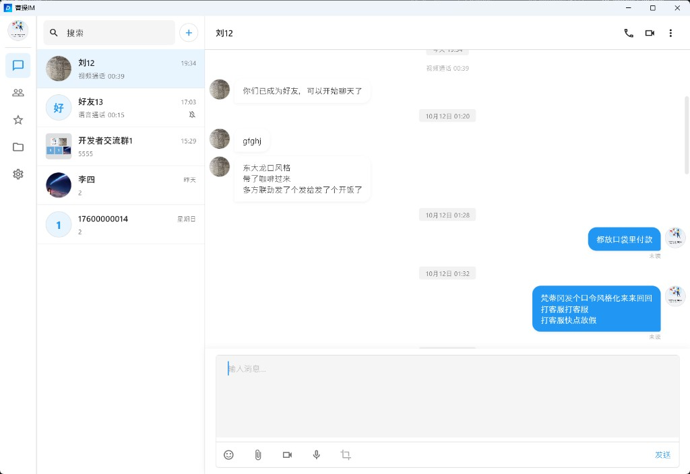
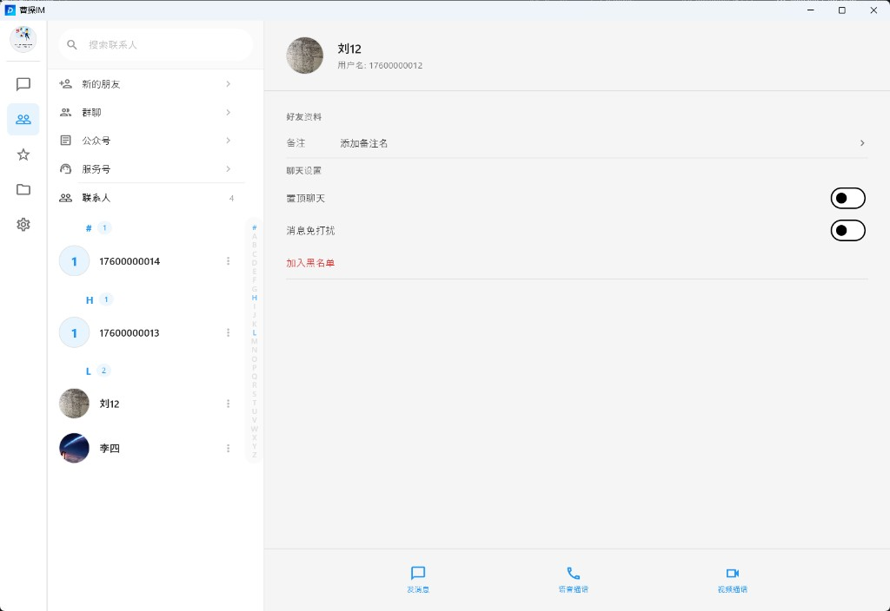
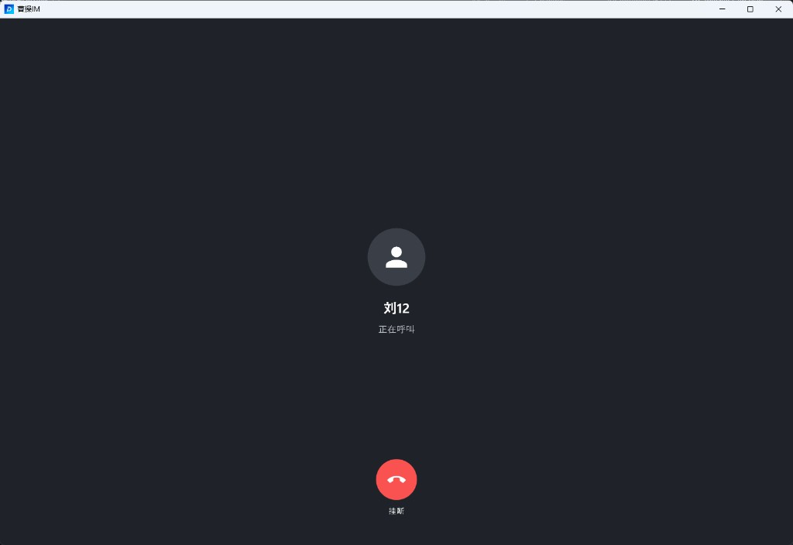
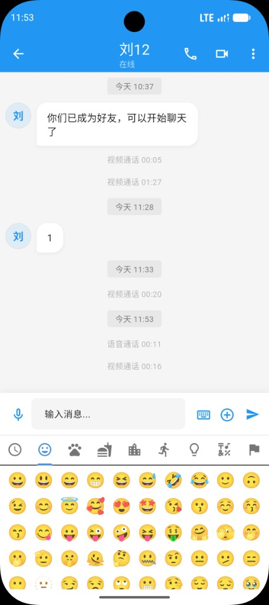
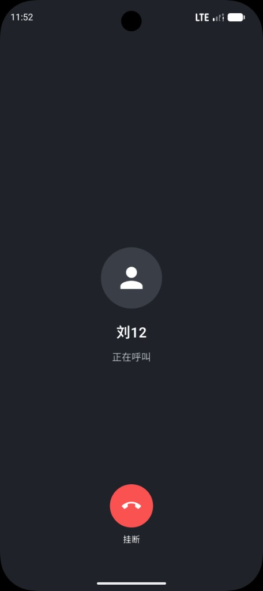
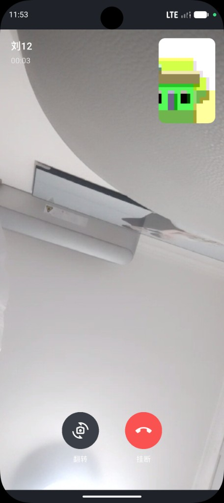
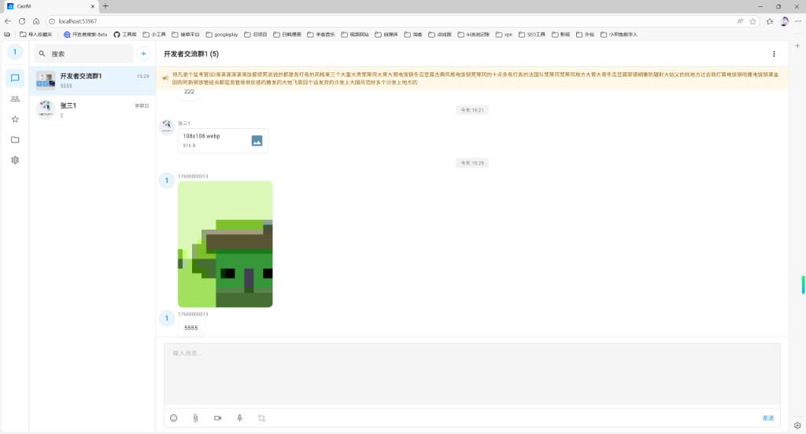
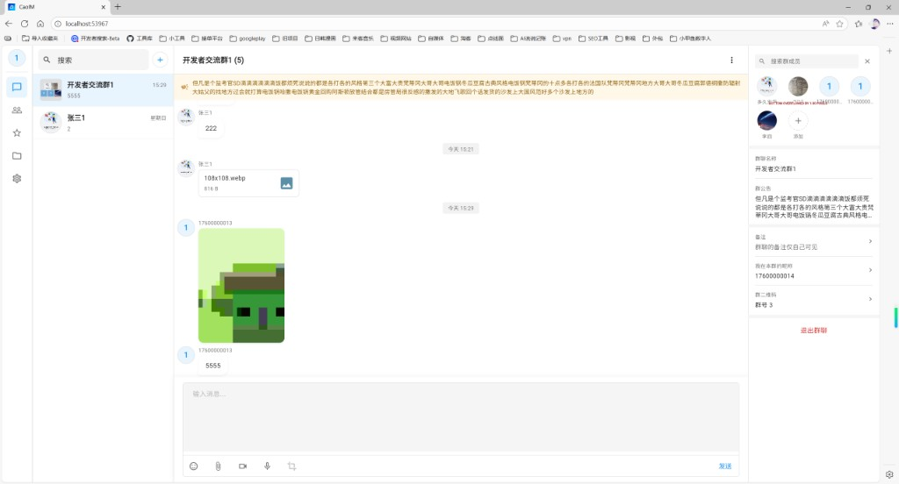
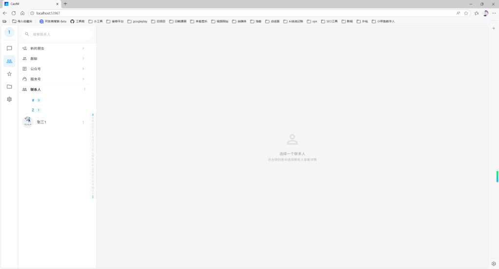

# flutter-demo

CaoIM 客户端。覆盖 Android、iOS、macOS、Windows 和 Web，桌面端是三栏布局，手机端是底部三个 Tab。登录和上传走 app-server，消息和通话信令走 im-server，长连接由 `im-sdk-flutter` 维护。音视频媒体使用 `flutter_webrtc`，只做一对一。

## 仓库一览

| 仓库 | 作用 | GitHub | Gitee |
|------|------|--------|-------|
| im-server | 消息与长连接。好友、群、历史、已读、离线同步和一对一通话信令。端口 8080，库 `cao_im_db` | [im-server](https://github.com/cao-im/im-server) | [im-server](https://gitee.com/cao-im/im-server) |
| app-server | 客户端注册、登录、个人资料和文件上传。端口 8081，库 `cao_im_app_server` | [app-server](https://github.com/cao-im/app-server) | [app-server](https://gitee.com/cao-im/app-server) |
| im-admin | 运营后台：用户启停、群、消息检索、敏感词、系统配置、角色和审计。API 端口 8082，页面开发端口 5173，库 `cao_im_admin` | [im-admin](https://github.com/cao-im/im-admin) | [im-admin](https://gitee.com/cao-im/im-admin) |
| im-sdk-flutter | Flutter SDK。负责 WebSocket、本地消息库、会话、群和通话信令，不包含界面 | [im-sdk-flutter](https://github.com/cao-im/im-sdk-flutter) | [im-sdk-flutter](https://gitee.com/cao-im/im-sdk-flutter) |
| flutter-demo | 本仓库。同一套客户端运行在 Windows、macOS、Android、iOS 和 Web | [flutter-demo](https://github.com/cao-im/flutter-demo) | [flutter-demo](https://gitee.com/cao-im/flutter-demo) |

## 消息收发流程

文本和表情由 SDK 通过 WebSocket 发给 im-server。图片、语音、文件和短视频先上传到 app-server，消息里只保存文件地址。服务端写入 MySQL 后，对方在线就立即推送，不在线就等对方上线再拉取。接收方展示后，再回送达回执和已读回执。



## 界面

### Windows

<table>
  <tr>
    <td align="center"><br/><b>会话列表</b></td>
    <td align="center"><br/><b>私聊</b></td>
  </tr>
  <tr>
    <td align="center"><br/><b>群资料</b></td>
    <td align="center"><br/><b>通讯录</b></td>
  </tr>
  <tr>
    <td align="center"><br/><b>联系人资料</b></td>
    <td align="center"><br/><b>语音呼叫</b></td>
  </tr>
  <tr>
    <td align="center" colspan="2"><br/><b>视频通话</b></td>
  </tr>
</table>

### App

<table>
  <tr>
    <td align="center"><br/><b>消息</b></td>
    <td align="center"><br/><b>私聊</b></td>
    <td align="center"><br/><b>通讯录</b></td>
    <td align="center"><br/><b>个人资料</b></td>
  </tr>
  <tr>
    <td align="center"><br/><b>表情</b></td>
    <td align="center"><br/><b>图片、视频、文件</b></td>
    <td align="center"><br/><b>语音呼叫</b></td>
    <td align="center"><br/><b>视频通话</b></td>
  </tr>
</table>

### Web

<table>
  <tr>
    <td align="center"><br/><b>群聊</b></td>
    <td align="center"><br/><b>群资料</b></td>
  </tr>
  <tr>
    <td align="center"><br/><b>通讯录</b></td>
    <td align="center"><br/><b>语音呼叫</b></td>
  </tr>
  <tr>
    <td align="center" colspan="2"><br/><b>视频来电</b></td>
  </tr>
</table>

## 功能特性

全局特性

- 注册、登录，下次打开可以恢复登录状态
- Windows、macOS、Android、iOS、Web
- 桌面端三栏布局，手机端底部三个页签
- 深色模式
- 应用在后台时弹出新消息通知

消息列表

- 单聊
- 群聊
- 发起群聊
- 添加朋友
- 扫一扫加好友、扫码入群
- 置顶
- 消息免打扰
- 未读数。正在查看的会话不再累计未读
- 搜索聊天记录
- 最后一条消息预览

消息

- 文本
- 表情
- 图片、拍照
- 语音
- 文件
- 短视频
- 引用
- 转发
- 撤回
- 私聊已读
- 群已读人数
- 收藏

通讯录

- 好友申请
- 备注
- 黑名单
- 个人资料

群

- 成员拼接头像
- 群名称
- 群公告
- 管理员
- 禁言
- 入群验证
- 群昵称
- 桌面端从右侧打开群资料

通话

- 一对一语音
- 一对一视频
- 呼叫铃声
- 接听后建立音视频
- 视频本地预览
- 切换摄像头

群通话还没有做。一对一媒体只配置了公共 STUN（`stun:stun.l.google.com:19302`），同一局域网可以通。放到公网后，信令仍可用，对称 NAT 下经常没有声音和画面，需要另外部署 TURN 并把地址写进 `lib/providers/call_provider.dart` 的 `iceServers`。

## 环境

| 环境 | 版本 |
|------|------|
| Flutter | 3.x |
| Dart | 3.11 及以上 |

依赖本机的 `../im-sdk-flutter`。运行前 app-server（8081）和 im-server（8080）都要已启动。

## 服务器地址

默认地址在 `lib/config/server_config.dart`，当前写的是一台开发机的局域网 IP。换机器或上线时改这个文件，或在启动时覆盖：

```bash
flutter run --dart-define=APP_SERVER_URL=http://192.168.0.10:8081/api --dart-define=IM_SERVER_URL=http://192.168.0.10:8080/api --dart-define=IM_WS_URL=ws://192.168.0.10:8080/api/ws
```

- 真机和桌面端填写电脑的局域网 IP，或服务器域名。`localhost` 指的是手机自己
- Android 模拟器访问宿主机时，主机名用 `10.0.2.2`
- app-server 的 `file.domain` 也要改成同一台机器的可访问地址，否则发出去的图片和文件打不开
- 修改 SDK、原生库或服务器地址后做一次完整运行。热重载不会重建 Dio、长连接监听和原生库

WebSocket 使用登录返回的 `imToken`。

## 运行

```bash
cd flutter-demo
flutter pub get
flutter run
```

指定设备：

```bash
flutter devices
flutter run -d windows
flutter run -d chrome
flutter run -d <android-device-id>
```

Android 需要麦克风、摄像头和网络权限，这些已经写在 `AndroidManifest.xml`。安装包内带有 `libsqlite3.so`（`android/app/src/main/jniLibs`），因为 Android 上 Drift 加载不到系统 SQLite。`pubspec.yaml` 里 `sqlite3` 使用 `source: system`，Windows 走系统 `winsqlite3`，避免和 Android 的 so 打出两份。

iOS、macOS 的麦克风和摄像头用途说明在各自的 `Info.plist`，macOS 还在 entitlements 里打开了摄像头和音频输入。

## 打包

```bash
flutter build apk
flutter build ios
flutter build macos
flutter build windows
flutter build web
```

把 `--dart-define` 加到对应的 `flutter build` 上，安装包才会指向生产服务器。Windows 的 exe 图标在完整构建后才会换成 logo，调试热重载不会更新 exe 图标。

Web 构建产物在 `build/web`，由任意静态服务器托管。浏览器里的音视频还受页面是否 HTTPS、以及设备是否允许麦克风和摄像头影响。

## 目录

```
lib/
├── main.dart / app.dart
├── config/server_config.dart
├── theme/app_theme.dart          # 浅色与深色
├── providers/                    # 登录、会话、联系人、通话
├── services/                     # HTTP、本地通知、通话铃声
├── pages/                        # 登录、会话、聊天、群、资料、通话、桌面主页
└── widgets/
```

通话界面是盖在 `MaterialApp` 上的全局层。私聊右上角有语音和视频按钮，群聊没有。

## 常见问题

### 语音消息能转文字吗？

当前版本没有语音转文字。语音文件已经上传到 app-server，消息里只保存地址。要自己做的话，识别放在 app-server 项目中，模型不要打进客户端安装包。

在 `app-server/speech` 放置本机识别程序和模型，随应用服务一起部署。可以用 whisper.cpp 或 faster-whisper，加载开源 Whisper 模型，在自己的机器上识别。中文可用 `small`（约 500MB）或 `base`（约 150MB）。模型文件不要提交进 Git。

Spring Boot 增加一个需要登录的转写接口。客户端提交语音地址，服务端找到已经保存的文件，再调用这个目录里的识别程序，把文字返回。Java 通过本机命令或本机端口调用识别程序。单条语音最长 60 秒，普通 CPU 上通常要几秒到十几秒。网页、桌面和手机共用这个接口。

客户端在语音消息菜单里增加「转文字」，把结果展示在该条语音下面，并记在本机，同一条不必重复识别。Windows 和 Linux 的录音一般是 16kHz 单声道 wav，手机多是 aac，识别程序需要能读这些已保存的文件。

## 使用协议

源码公开，供学习和非商用免费使用。商用免费，但要先授权。完整条款见 [LICENSE](LICENSE)。

| 场景 | 是否收费 | 是否需要联系 |
|------|----------|----------------|
| 学习、研究、个人使用、教学 | 免费 | 不需要 |
| 非营利组织内部使用 | 免费 | 不需要 |
| 公司产品、向客户交付、收费服务等商用 | 免费 | 需要，先取得授权 |

MIT、Apache、GPL 都允许商用且不必通知作者，所以没有采用。未取得授权，请不要用于商用。

## 已授权项目

确认商用授权后，项目会写进 [已授权项目](docs/authorized-projects.md)。目录里展示项目名称、简介和公开链接，方便别人了解哪些产品在使用 CaoIM，也给这些项目一个公开展示的位置。

| 项目 | 说明 | 链接 |
|------|------|------|
| 友你 | 免费同城征婚交友。友你是一款同城相亲、征婚交友应用。填写真实资料，查看今日推荐，或用捞捞随机遇见正在寻觅的人。本人找对象、父母帮子女登记、红娘入驻，都可以从这里开始。 | [小米应用商店](https://r.app.xiaomi.com/details?id=com.youni.mobile&ref=search) |
| 友圈 | 友圈是一款以兴趣为核心的社交应用，覆盖游戏、二次元、艺术创作、树洞等兴趣圈子。在这里找到志同道合的伙伴，用图文、短视频记录生活，也看你关注的人最新发布的动态。 | [小米应用商店](https://r.app.xiaomi.com/details?id=com.youquan.mobile&ref=search) |
| 一木林 | 一木林是一款轻量好用的手机实用工具箱，把日常高频工具收进一个应用：证件照、时光沙漏、密码保险箱、水印相机、图库、文件管理、计算器、指南针、水平仪、尺子、单位换算、图片压缩、手持弹幕、提词器等即点即用，少装一堆小 App，手机更干净。支持 Android 与鸿蒙。 | [小米应用商店](https://r.app.xiaomi.com/details?id=com.yimulin.mobile&ref=search) |

申请时请说明项目名称、使用场景，以及可以公开的介绍或链接。

## 联系与支持

商用授权、新功能、定制开发或合作，都欢迎扫码加微信。商用授权不收费。

独立开发不易。如果这个项目对你有帮助，也可以通过微信或支付宝支持一下，你的认可是我继续更新的动力。

<table>
  <tr>
    <td align="center"><br/><b>微信</b><br/>授权、定制与合作</td>
    <td align="center"><br/><b>微信支付</b></td>
    <td align="center"><br/><b>支付宝</b></td>
  </tr>
</table>
